# EduQuiz – Online Quiz Management System

A PHP and MySQL web application for the **Web Technologies (CSC 3215)** course.
Admins, Instructors and Students log in to their own panel: instructors create courses and quizzes,
students enroll and take quizzes, and admins manage users and courses.

## Features

- One login and registration system for every user (Student or Instructor sign-up).
- Remember Me, reset password, change password, edit profile and delete account.
- Live AJAX check for username, email and phone while registering.
- **Student:** browse and enroll in courses, take quizzes, see results and average score.
- **Instructor:** create courses and quizzes, add questions, publish quizzes, see student results with Pass / Fail (pass mark 40%).
- **Admin:** activate / deactivate / delete users, remove courses, see a system report.

## Built With

PHP · MySQL · HTML · CSS · JavaScript (AJAX) · XAMPP — following the **MVC** pattern.

## Project Structure (MVC)

```
WebTech-EduQuiz-Online-Quiz-Management-System/
├── index.php                 # start page: sends the user to Login or to their dashboard
├── model/                    # MODEL: every database query
│   ├── DatabaseConnection.php   # connection + user/account queries
│   ├── AdminModel.php
│   ├── InstructorModel.php
│   └── StudentModel.php
├── Auth/                     # pages shared by all users
│   ├── View/                 # VIEW: Login, Registration, ForgotPassword, Profile, Password
│   ├── Control/              # CONTROLLER: checks the forms, AJAX checks, logout
│   └── JavaScript/           # form validation + AJAX
├── Admin/                    # Admin panel   (MainPage.php, View/, Control/)
├── Instructor/               # Instructor panel (MainPage.php, View/, Control/)
├── Student/                  # Student panel (MainPage.php, View/, Control/)
├── css/style.css
├── database/eduquiz.sql      # creates the database with demo data
├── report/                   # project report (LaTeX source + PDF)
└── Screenshots/
```

- **Model** – only talks to the database.
- **View** – only shows the page (HTML).
- **Controller** – reads the form, calls the Model and decides what the View shows.

## Requirements

- **XAMPP** (Apache + MySQL + PHP 8) – download from [apachefriends.org](https://www.apachefriends.org/)
- **Git** – download from [git-scm.com](https://git-scm.com/downloads)
- A web browser (Chrome, Edge, Firefox)
- (Optional) **VS Code** to read or edit the code

## Clone the Project

Open a terminal inside the XAMPP `htdocs` folder (usually `C:\xampp\htdocs`) and run:

```bash
git clone https://github.com/munshi-rishad/WebTech-EduQuiz-Online-Quiz-Management-System.git
```

## Setup and Run

1. Install XAMPP, open the **XAMPP Control Panel** and click **Start** for **Apache** and **MySQL**.
2. Clone the project into `C:\xampp\htdocs` (see above).
3. Open **http://localhost/phpmyadmin**, click the **Import** tab, choose `database/eduquiz.sql` and click **Import**.
   This creates the `eduquiz_short` database with demo data.
4. Open the project in the browser:
   **http://localhost/WebTech-EduQuiz-Online-Quiz-Management-System/**
5. Log in with one of the demo accounts below.

> If your MySQL user or password is not the XAMPP default (`root` with no password), change them in `model/DatabaseConnection.php`.

### Demo Accounts

| Role | Email | Password |
|------|-------|----------|
| Admin | admin@eduquiz.local | admin123 |
| Instructor | instructor@eduquiz.local | instructor123 |
| Student | student@eduquiz.local | student123 |

New Student and Instructor accounts can be created from the **Register** page.

## Project Report

The report is written in LaTeX: [report/EduQuiz_Report.tex](report/EduQuiz_Report.tex) · PDF: [report/EduQuiz_Report.pdf](report/EduQuiz_Report.pdf)

## Screenshots

### Login & Registration

<table>
  <tr>
    <td width="50%" align="center">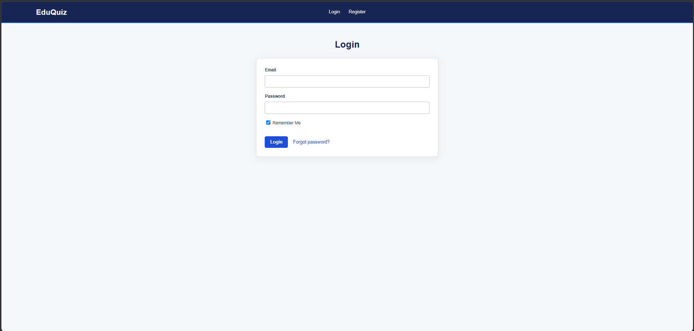<br><sub>Login page</sub></td>
    <td width="50%" align="center">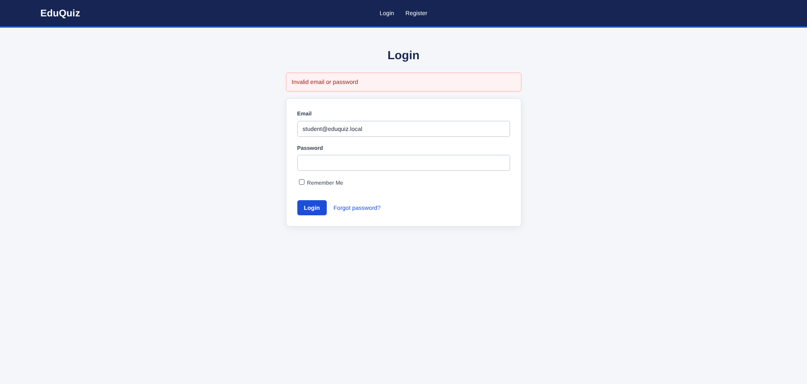<br><sub>Wrong email or password</sub></td>
  </tr>
  <tr>
    <td width="50%" align="center">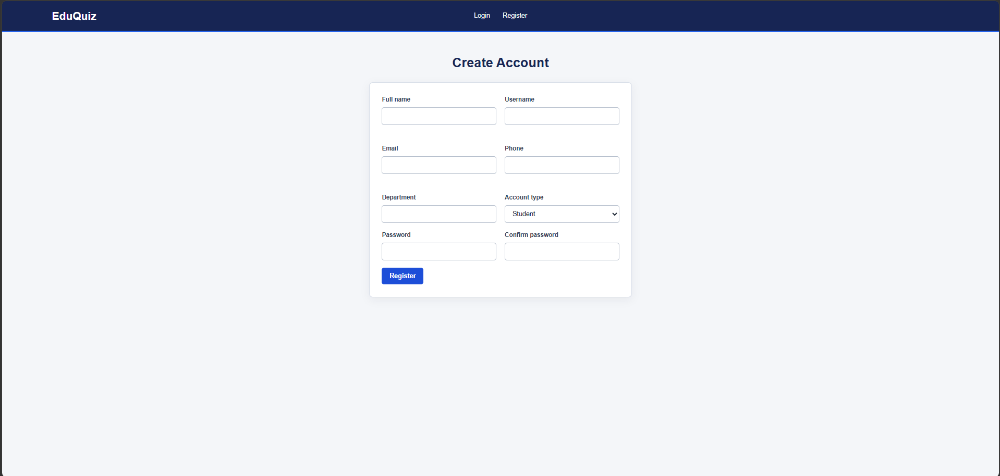<br><sub>Create account (Student or Instructor)</sub></td>
    <td width="50%" align="center">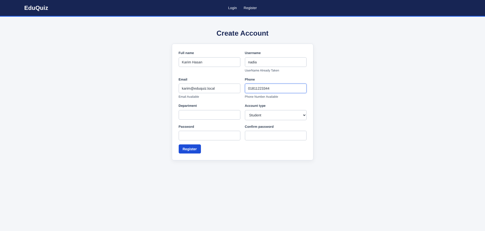<br><sub>Live AJAX check for username, email and phone</sub></td>
  </tr>
</table>

### Account

<table>
  <tr>
    <td width="50%" align="center">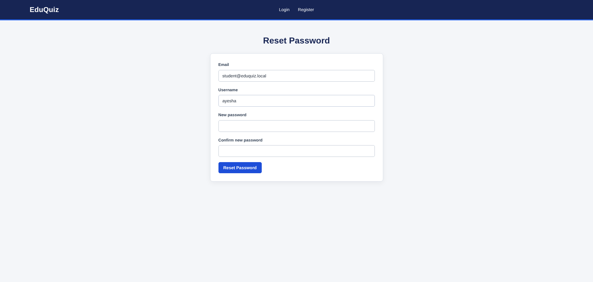<br><sub>Reset password with email + username</sub></td>
    <td width="50%" align="center">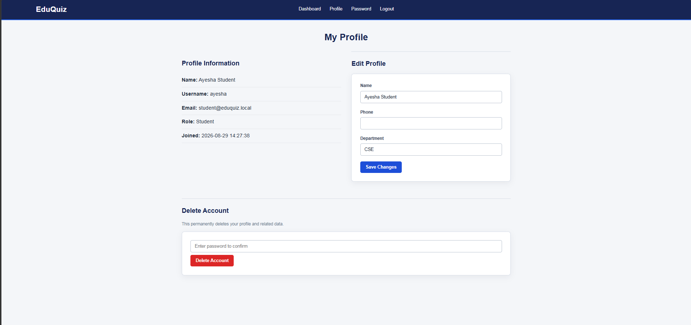<br><sub>View and edit profile, delete account</sub></td>
  </tr>
  <tr>
    <td width="50%" align="center">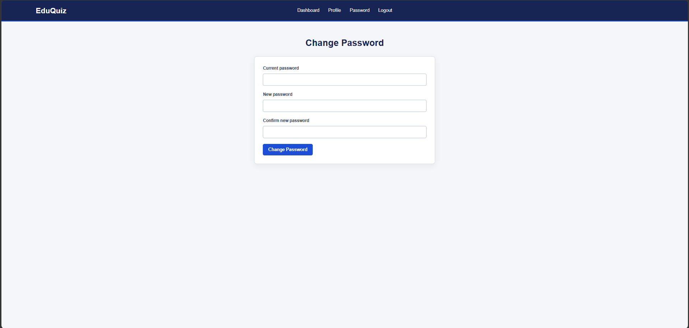<br><sub>Change password</sub></td>
    <td width="50%"></td>
  </tr>
</table>

### Student Panel

<table>
  <tr>
    <td width="50%" align="center">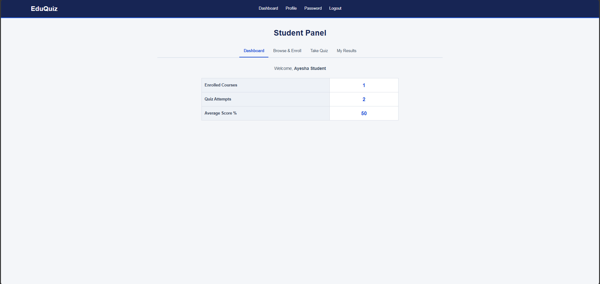<br><sub>Dashboard: courses, attempts and average score</sub></td>
    <td width="50%" align="center">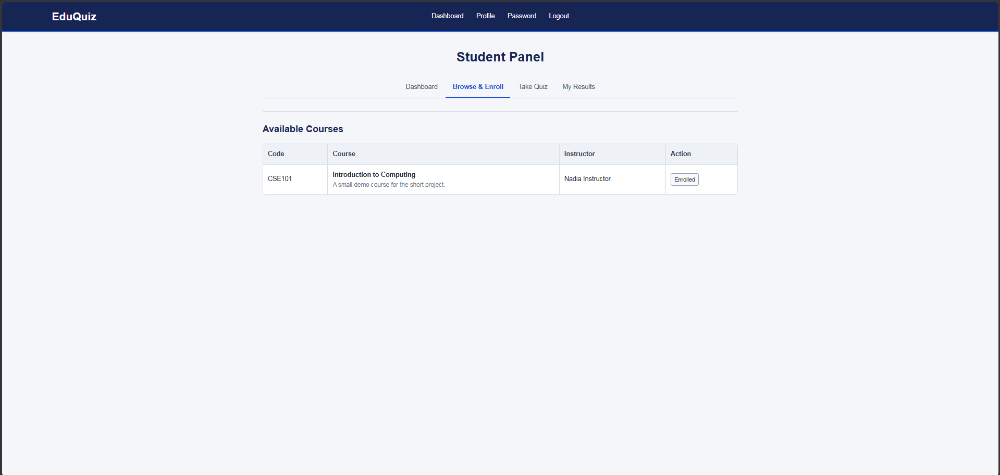<br><sub>Browse courses and enroll</sub></td>
  </tr>
  <tr>
    <td width="50%" align="center">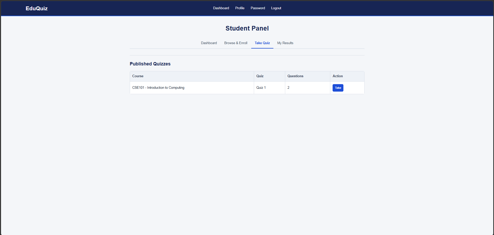<br><sub>Published quizzes of enrolled courses</sub></td>
    <td width="50%" align="center">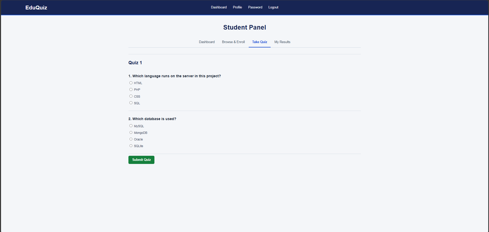<br><sub>Take a multiple-choice quiz</sub></td>
  </tr>
  <tr>
    <td width="50%" align="center">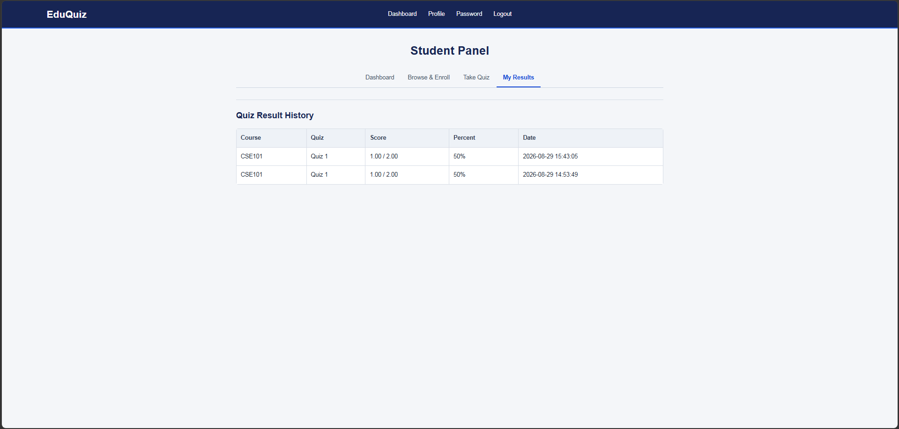<br><sub>Result history with score and percent</sub></td>
    <td width="50%"></td>
  </tr>
</table>

### Instructor Panel

<table>
  <tr>
    <td width="50%" align="center">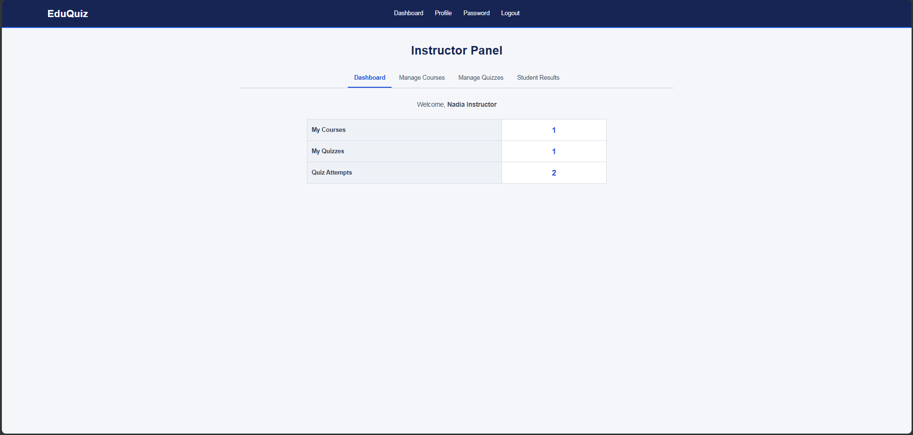<br><sub>Dashboard: my courses, quizzes and attempts</sub></td>
    <td width="50%" align="center">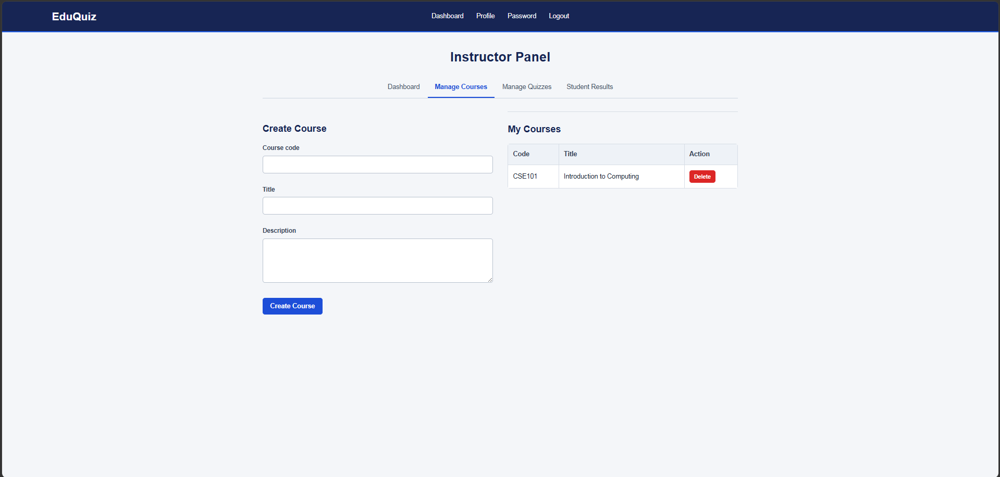<br><sub>Create and delete courses</sub></td>
  </tr>
  <tr>
    <td width="50%" align="center">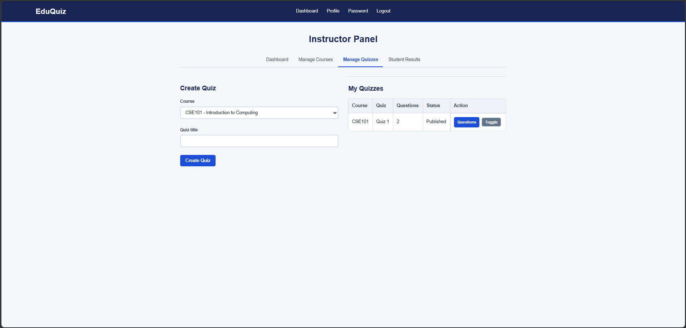<br><sub>Create quizzes and publish / unpublish them</sub></td>
    <td width="50%" align="center">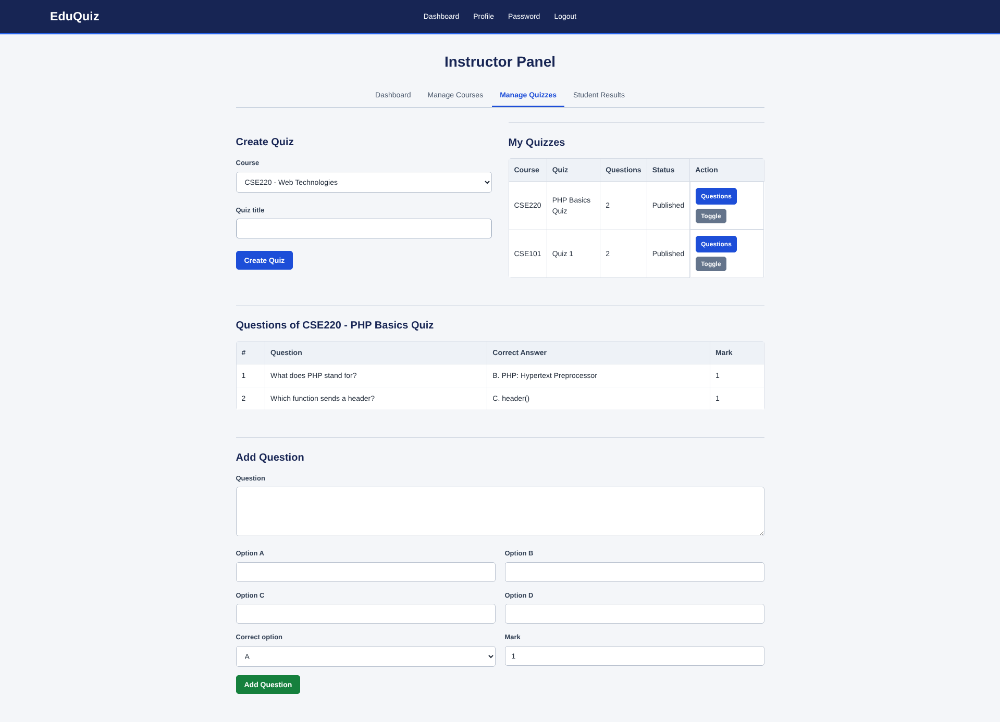<br><sub>Questions of a quiz and the Add Question form</sub></td>
  </tr>
  <tr>
    <td width="50%" align="center">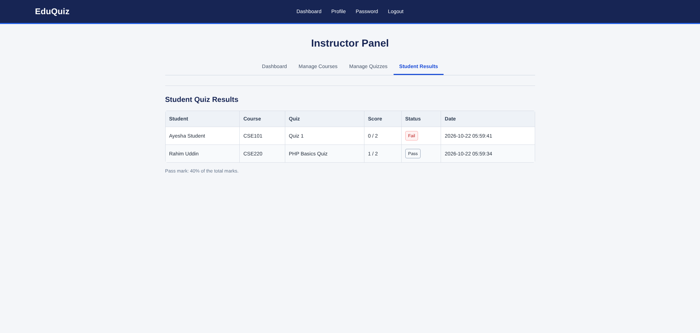<br><sub>Student results with Pass / Fail</sub></td>
    <td width="50%"></td>
  </tr>
</table>

### Admin Panel

<table>
  <tr>
    <td width="50%" align="center">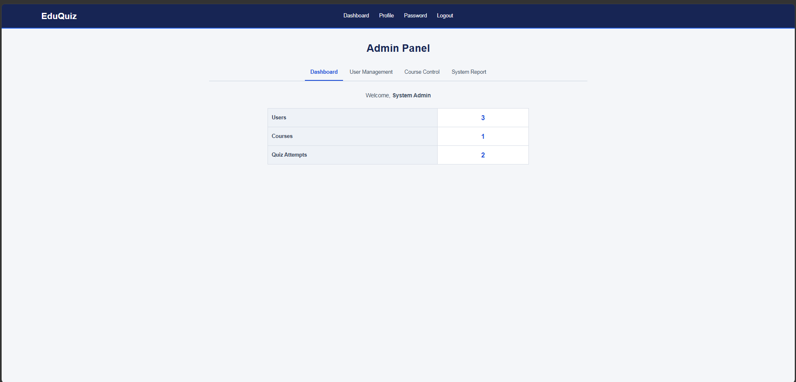<br><sub>Dashboard: users, courses and attempts</sub></td>
    <td width="50%" align="center">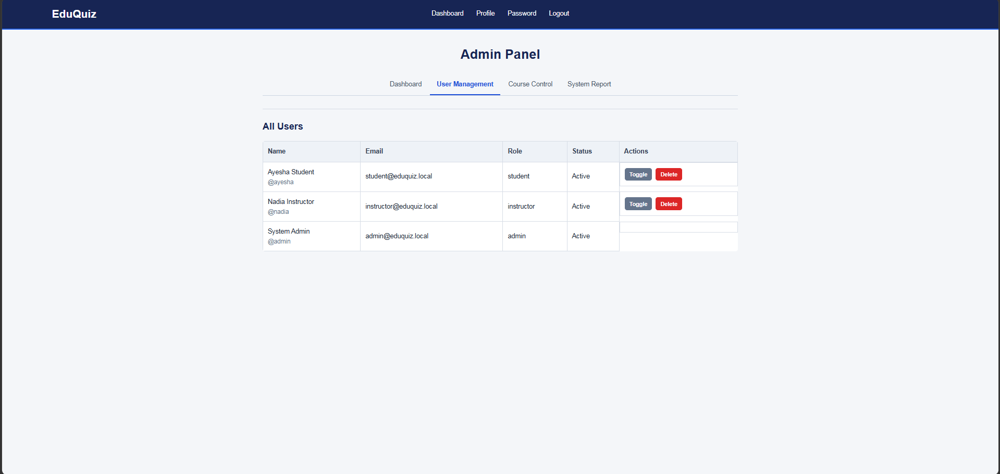<br><sub>Activate / deactivate or delete users</sub></td>
  </tr>
  <tr>
    <td width="50%" align="center">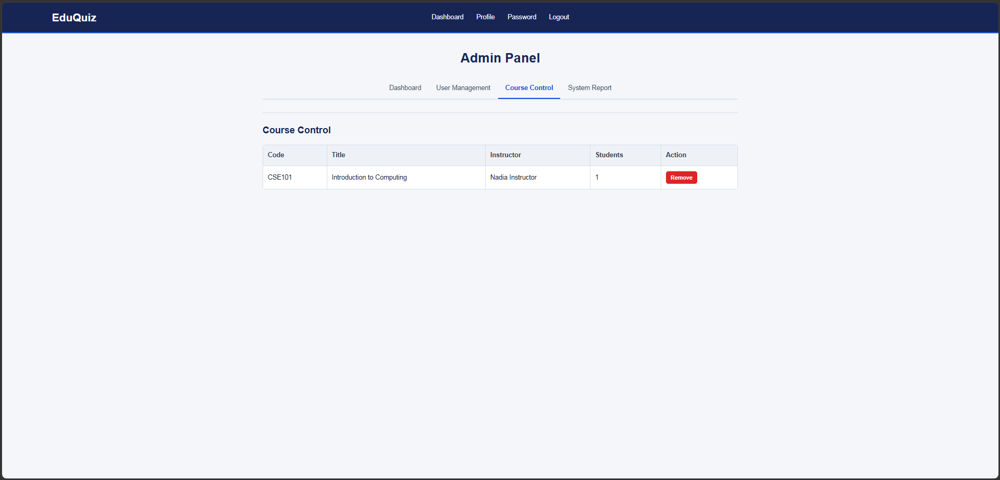<br><sub>See and remove courses</sub></td>
    <td width="50%" align="center">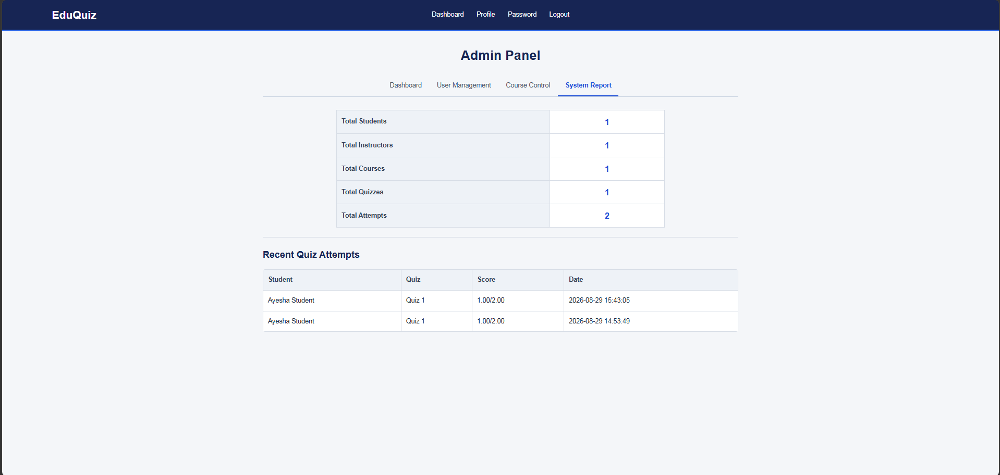<br><sub>System report and recent attempts</sub></td>
  </tr>
</table>
